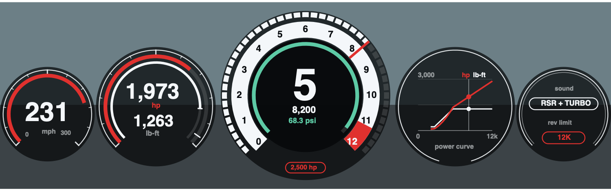

# sim-rig

A MOZA sim rig running Assetto Corsa on an Apple-silicon Mac, with no Windows and no Pit House.
Assetto Corsa runs under CrossOver; everything that talks to the hardware runs natively on macOS.

| Folder | What it is |
|---|---|
| [`moza-phf/`](moza-phf) | Pedal haptics for the MOZA PHF Control Box, driven from the game's telemetry. Also the control board (a local web page for haptic strengths, per-car rev lights, lap charts and a speed-coloured track map) and the lap recorder and analysis behind it. Python, `pyserial` only. |
| [`rig/`](rig) | The wheel dashboard bridge (`moza-dash.py`: rev lights and the wheel's screen), the launcher that starts everything, and the settings file. |
| [`assetto-corsa/apps/rig_power/`](assetto-corsa/apps/rig_power) | An in-game app (Custom Shaders Patch, Lua): boost dial, live horsepower and torque, the power curve the car really makes, and on some cars a boost-map switch and an engine-sound switch. |
| [`assetto-corsa/gt2rs-2000/`](assetto-corsa/gt2rs-2000) | A script that turns a 911 GT2 RS mod into a track build, with the lap times at each step. |
| [`macan-s/`](macan-s) | A script that builds three 2021 Macan S cars (stock, Stage 2, 1,000 hp) from the official Macan Turbo. |
| [`results/`](results) | The lap log: every lap time and sector from every session, with charts for the Ferrari F2004 and the Nordschleife. |
| [`laps/`](laps) | Every lap the recorder has saved: speed, pedals, position and per-wheel data on 2,000 steps round the track. |

The in-game cluster, drawn off-game from the app's own code by [`tools/render_app.lua`](tools/render_app.lua). Its face goes from
white to black-with-red-ticks to solid red as the revs approach the limit.

## Doing this yourself

[`docs/SETUP.md`](docs/SETUP.md) is the whole path on a Mac: Assetto Corsa in CrossOver, force feedback through
Torqer, the wheel's lights and screen, pedal haptics, and getting the No Hesi launcher to run, with the settings
and registry values that made each one work.

## Running it

The rig runs from `~/dev/moza-phf` and `~/dev/moza-rig`, not from this folder. `rig/start-rig.sh` finds the
wheel base and the control box by USB id, starts the dashboard bridge, the haptics and the control board, and
opens the board at http://127.0.0.1:8765. See [`moza-phf/README.md`](moza-phf/README.md) for setup and for an
honest list of what has been checked against real hardware and what has not.

`./backup.sh` copies the live files into this folder so they can be committed.

## Credits and licences

- The control box's wire command was decoded by the
  [moza-simhub-plugin](https://github.com/giantorth/moza-simhub-plugin) project; `moza-phf` implements it and is GPL-3.0-or-later.
- The launcher icon is a photo of a Ferrari F40 by Will ainsworth, CC BY-SA 3.0; see [`rig/icon-credit.txt`](rig/icon-credit.txt).
- No game or mod files are included: the car scripts edit copies you already have.
