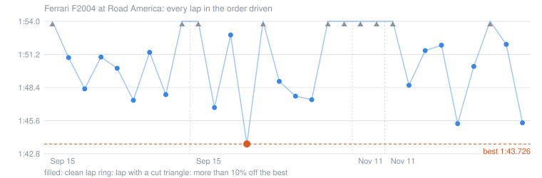
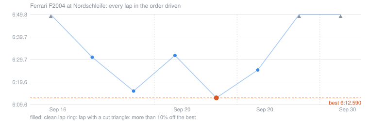
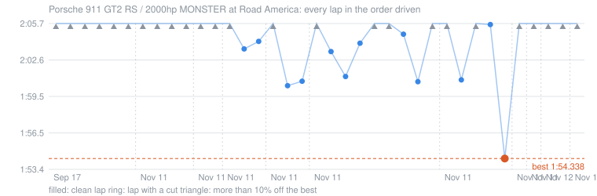
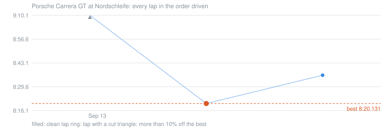
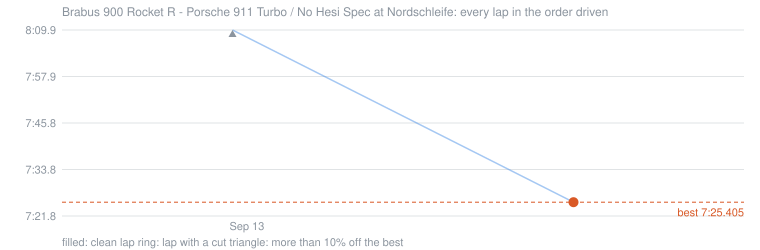
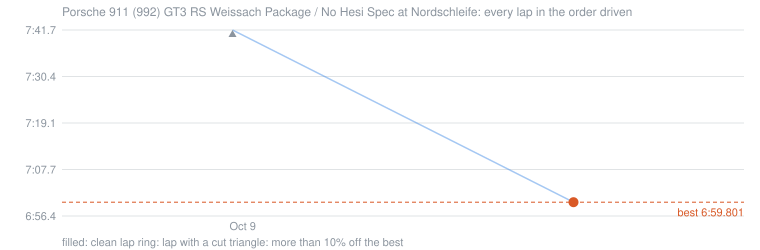

# Lap log

275 laps in 70 sessions, 2026-09-12 to 2026-11-12. Written by [`tools/session_report.py`](../tools/session_report.py) from Content Manager's saved sessions; the first lap of a session starts from the pits, so it is always slow.

## Ferrari F2004

### Ferrari F2004 at Road America

Best lap **1:43.726** on 2026-09-15, on M tyres. Best sectors added together: **1:42.349**, 1.377 s quicker.

| Date | Laps | Tyres | Best | Median clean lap | Spread of clean laps |
|---|---|---|---|---|---|
| 2026-09-15 23:01 | 9 | M | 1:47.420 | 1:50.131 | 4.1 s |
| 2026-09-15 23:34 | 10 | M | 1:43.726 | 1:47.773 | 9.2 s |
| 2026-11-11 19:20 | 2 | M | 1:59.682 | 1:59.682 | - |
| 2026-11-11 19:48 | 9 | M | 1:45.446 | 1:50.288 | 6.7 s |

Every lap

| Date | Lap | Time | S1 | S2 | S3 | Tyres | Cuts |
|---|---|---|---|---|---|---|---|
| 2026-09-15 | 1 | 2:19.267 | 1:09.629 | 0:37.895 | 0:31.743 | M |  |
| 2026-09-15 | 2 | 1:51.034 | 0:38.633 | 0:39.281 | 0:33.120 | M |  |
| 2026-09-15 | 3 | 1:48.388 | 0:39.628 | 0:38.308 | 0:30.452 | M |  |
| 2026-09-15 | 4 | 1:51.083 | 0:39.182 | 0:40.950 | 0:30.951 | M |  |
| 2026-09-15 | 5 | 1:50.131 | 0:39.967 | 0:36.950 | 0:33.214 | M |  |
| 2026-09-15 | 6 | 1:47.420 | 0:42.080 | 0:35.996 | 0:29.344 | M |  |
| 2026-09-15 | 7 | 1:51.476 | 0:38.117 | 0:40.537 | 0:32.822 | M |  |
| 2026-09-15 | 8 | 1:47.903 | 0:38.441 | 0:38.323 | 0:31.139 | M |  |
| 2026-09-15 | 9 | 2:15.308 | 0:39.270 | 0:41.318 | 0:54.720 | M |  |
| 2026-09-15 | 1 | 2:27.003 | 1:14.256 | 0:39.010 | 0:33.737 | M |  |
| 2026-09-15 | 2 | 1:46.807 | 0:39.064 | 0:37.381 | 0:30.362 | M |  |
| 2026-09-15 | 3 | 1:52.951 | 0:39.803 | 0:37.180 | 0:35.968 | M |  |
| 2026-09-15 | 4 | **1:43.726** | 0:37.846 | 0:37.039 | 0:28.841 | M |  |
| 2026-09-15 | 5 | 1:55.651 | 0:39.506 | 0:42.665 | 0:33.480 | M |  |
| 2026-09-15 | 6 | 1:49.022 | 0:39.561 | 0:36.841 | 0:32.620 | M |  |
| 2026-09-15 | 7 | 1:47.773 | 0:39.517 | 0:36.099 | 0:32.157 | M |  |
| 2026-09-15 | 8 | 1:47.475 | 0:38.867 | 0:37.242 | 0:31.366 | M |  |
| 2026-09-15 | 9 | 2:08.510 | 0:42.826 | 0:42.885 | 0:42.799 | M |  |
| 2026-09-15 | 10 | 2:27.670 | 0:42.257 | 0:50.990 | 0:54.423 | M |  |
| 2026-11-11 | 1 | 2:55.182 | 1:39.788 | 0:40.829 | 0:34.565 | M |  |
| 2026-11-11 | 2 | 1:59.682 | 0:48.672 | 0:38.915 | 0:32.095 | M |  |
| 2026-11-11 | 1 | 2:12.463 | 1:06.628 | 0:36.940 | 0:28.895 | M |  |
| 2026-11-11 | 2 | 1:48.690 | 0:38.521 | 0:35.662 | 0:34.507 | M |  |
| 2026-11-11 | 3 | 1:51.626 | 0:43.852 | 0:37.184 | 0:30.590 | M |  |
| 2026-11-11 | 4 | 1:52.079 | 0:40.048 | 0:41.224 | 0:30.807 | M |  |
| 2026-11-11 | 5 | 1:45.446 | 0:38.464 | 0:36.995 | 0:29.987 | M |  |
| 2026-11-11 | 6 | 1:50.288 | 0:39.369 | 0:39.743 | 0:31.176 | M |  |
| 2026-11-11 | 7 | 1:56.003 | 0:45.223 | 0:37.602 | 0:33.178 | M |  |
| 2026-11-11 | 8 | 1:52.151 | 0:38.631 | 0:38.789 | 0:34.731 | M |  |
| 2026-11-11 | 9 | 1:45.519 | 0:38.289 | 0:36.544 | 0:30.686 | M |  |

### Ferrari F2004 at Nordschleife

Best lap **6:12.590** on 2026-09-20, on M tyres. Best sectors added together: **6:02.406**, 10.184 s quicker.

| Date | Laps | Tyres | Best | Median clean lap | Spread of clean laps |
|---|---|---|---|---|---|
| 2026-09-16 00:01 | 3 | M | 6:15.646 | 6:30.771 | 15.1 s |
| 2026-09-20 00:27 | 2 | M | 6:12.590 | 6:31.581 | 19.0 s |
| 2026-09-20 00:59 | 2 | M | 6:25.064 | 6:25.064 | - |
| 2026-09-30 18:33 | 1 | M | 7:16.932 | 7:16.932 | - |

Every lap

| Date | Lap | Time | S1 | S2 | S3 | Tyres | Cuts |
|---|---|---|---|---|---|---|---|
| 2026-09-16 | 1 | 7:13.392 | 2:01.560 | 2:36.311 | 2:35.521 | M |  |
| 2026-09-16 | 2 | 6:30.771 | 1:47.522 | 2:06.694 | 2:36.555 | M |  |
| 2026-09-16 | 3 | 6:15.646 | 1:36.628 | 2:03.111 | 2:35.907 | M |  |
| 2026-09-20 | 1 | 6:31.581 | 1:55.578 | 1:59.794 | 2:36.209 | M |  |
| 2026-09-20 | 2 | **6:12.590** | 1:41.331 | 2:05.275 | 2:25.984 | M |  |
| 2026-09-20 | 1 | 6:25.064 | 1:49.368 | 2:03.497 | 2:32.199 | M |  |
| 2026-09-20 | 2 | 7:27.950 | 1:54.239 | 2:09.987 | 3:23.724 | M |  |
| 2026-09-30 | 1 | 7:16.932 | 1:59.443 | 2:06.653 | 3:10.836 | M |  |

## Porsche 911 GT2 RS track build

### Porsche 911 GT2 RS / 2500hp MONSTER at Road America

Best lap **1:54.338** on 2026-11-11, on Slick tyres. Best sectors added together: **1:53.374**, 0.964 s quicker.

| Date | Laps | Tyres | Best | Median clean lap | Spread of clean laps |
|---|---|---|---|---|---|
| 2026-09-17 00:56 | 6 | Michelin Cup2 | 2:14.822 | 2:15.058 | 9.7 s |
| 2026-11-11 20:40 | 4 | Michelin Cup2 | 2:19.805 | 2:21.465 | 8.8 s |
| 2026-11-11 20:55 | 2 | Michelin Cup2 | 2:10.853 | 2:10.853 | - |
| 2026-11-11 21:10 | 3 | Slick | 2:03.624 | 2:04.258 | 0.6 s |
| 2026-11-11 21:28 | 3 | Slick | 2:00.510 | 2:00.887 | 0.4 s |
| 2026-11-11 22:06 | 9 | Slick | 2:00.844 | 2:04.105 | 9.6 s |
| 2026-11-11 22:35 | 5 | Slick | 1:54.338 | 2:01.001 | 11.3 s |
| 2026-11-11 23:03 | 1 | Slick | 4:08.978 | 4:08.978 | - |
| 2026-11-11 23:43 | 1 | Slick | 7:11.695 | 7:11.695 | - |
| 2026-11-12 00:03 | 2 | Slick | 2:52.800 | 2:52.800 | - |
| 2026-11-12 00:22 | 1 | Slick | 3:23.383 | 3:23.383 | - |
| 2026-11-12 00:40 | 3 | Slick | 1:57.546 | 2:03.556 | 6.0 s |

Every lap

| Date | Lap | Time | S1 | S2 | S3 | Tyres | Cuts |
|---|---|---|---|---|---|---|---|
| 2026-09-17 | 1 | 3:17.061 | 1:35.842 | 0:58.270 | 0:42.949 | Michelin Cup2 |  |
| 2026-09-17 | 2 | 2:33.063 | 0:54.620 | 1:00.467 | 0:37.976 | Michelin Cup2 |  |
| 2026-09-17 | 3 | 2:15.058 | 0:45.184 | 0:52.299 | 0:37.575 | Michelin Cup2 |  |
| 2026-09-17 | 4 | 2:24.496 | 0:50.459 | 0:54.599 | 0:39.438 | Michelin Cup2 |  |
| 2026-09-17 | 5 | 2:57.071 | 0:57.079 | 1:11.676 | 0:48.316 | Michelin Cup2 |  |
| 2026-09-17 | 6 | 2:14.822 | 0:46.830 | 0:51.133 | 0:36.859 | Michelin Cup2 |  |
| 2026-11-11 | 1 | 3:24.931 | 1:50.318 | 0:59.113 | 0:35.500 | Michelin Cup2 |  |
| 2026-11-11 | 2 | 2:28.632 | 0:52.957 | 0:52.123 | 0:43.552 | Michelin Cup2 |  |
| 2026-11-11 | 3 | 2:19.805 | 0:45.783 | 0:51.781 | 0:42.241 | Michelin Cup2 |  |
| 2026-11-11 | 4 | 2:21.465 | 0:54.155 | 0:50.432 | 0:36.878 | Michelin Cup2 |  |
| 2026-11-11 | 1 | 3:38.291 | 2:12.395 | 0:49.568 | 0:36.328 | Michelin Cup2 |  |
| 2026-11-11 | 2 | 2:10.853 | 0:43.707 | 0:49.432 | 0:37.714 | Michelin Cup2 |  |
| 2026-11-11 | 1 | 3:23.478 | 1:57.811 | 0:48.758 | 0:36.909 | Slick |  |
| 2026-11-11 | 2 | 2:03.624 | 0:41.773 | 0:48.055 | 0:33.796 | Slick |  |
| 2026-11-11 | 3 | 2:04.258 | 0:43.028 | 0:46.454 | 0:34.776 | Slick |  |
| 2026-11-11 | 1 | 2:24.129 | 1:06.323 | 0:43.317 | 0:34.489 | Slick |  |
| 2026-11-11 | 2 | 2:00.510 | 0:42.169 | 0:43.420 | 0:34.921 | Slick |  |
| 2026-11-11 | 3 | 2:00.887 | 0:44.167 | 0:43.268 | 0:33.452 | Slick |  |
| 2026-11-11 | 1 | 3:05.027 | 1:45.809 | 0:47.151 | 0:32.067 | Slick |  |
| 2026-11-11 | 2 | 2:03.392 | 0:44.805 | 0:46.115 | 0:32.472 | Slick |  |
| 2026-11-11 | 3 | 2:01.287 | 0:43.248 | 0:44.473 | 0:33.566 | Slick |  |
| 2026-11-11 | 4 | 2:04.105 | 0:44.459 | 0:45.558 | 0:34.088 | Slick |  |
| 2026-11-11 | 5 | 2:10.488 | 0:52.035 | 0:43.037 | 0:35.416 | Slick |  |
| 2026-11-11 | 6 | 2:06.517 | 0:45.207 | 0:47.591 | 0:33.719 | Slick |  |
| 2026-11-11 | 7 | 2:04.867 | 0:47.026 | 0:45.022 | 0:32.819 | Slick |  |
| 2026-11-11 | 8 | 2:00.844 | 0:39.633 | 0:47.943 | 0:33.268 | Slick |  |
| 2026-11-11 | 9 | 2:15.892 | 0:46.905 | 0:53.810 | 0:35.177 | Slick |  |
| 2026-11-11 | 1 | 3:56.512 | 2:34.153 | 0:49.734 | 0:32.625 | Slick |  |
| 2026-11-11 | 2 | 2:01.001 | 0:43.327 | 0:45.175 | 0:32.499 | Slick |  |
| 2026-11-11 | 3 | 2:06.768 | 0:43.049 | 0:48.407 | 0:35.312 | Slick |  |
| 2026-11-11 | 4 | 2:05.684 | 0:42.529 | 0:51.061 | 0:32.094 | Slick |  |
| 2026-11-11 | 5 | **1:54.338** | 0:38.905 | 0:43.934 | 0:31.499 | Slick |  |
| 2026-11-11 | 1 | 4:08.978 | 1:45.176 | 1:44.436 | 0:39.366 | Slick |  |
| 2026-11-11 | 1 | 7:11.695 | 3:22.028 | 2:41.775 | 1:07.892 | Slick |  |
| 2026-11-12 | 1 | 3:45.987 | 1:52.308 | 0:59.953 | 0:53.726 | Slick |  |
| 2026-11-12 | 2 | 2:52.800 | 1:18.416 | 0:58.339 | 0:36.045 | Slick |  |
| 2026-11-12 | 1 | 3:23.383 | 1:27.072 | 1:01.762 | 0:54.549 | Slick |  |
| 2026-11-12 | 1 | 2:21.508 | 1:04.383 | 0:44.590 | 0:32.535 | Slick |  |
| 2026-11-12 | 2 | 1:57.546 | 0:42.729 | 0:42.970 | 0:31.847 | Slick |  |
| 2026-11-12 | 3 | 2:03.556 | 0:44.144 | 0:44.235 | 0:35.177 | Slick |  |

## Nürburgring Nordschleife, other cars

### Porsche Carrera GT at Nordschleife

Best lap **8:20.131** on 2026-09-13, on Hypercar road tyres. Best sectors added together: **8:20.131**, 0.000 s quicker.

| Date | Laps | Tyres | Best | Median clean lap | Spread of clean laps |
|---|---|---|---|---|---|
| 2026-09-13 01:41 | 3 | Hypercar road | 8:20.131 | 8:36.192 | 16.1 s |

Every lap

| Date | Lap | Time | S1 | S2 | S3 | Tyres | Cuts |
|---|---|---|---|---|---|---|---|
| 2026-09-13 | 1 | 9:10.858 | 2:22.447 | 3:15.219 | 3:33.192 | Hypercar road |  |
| 2026-09-13 | 2 | **8:20.131** | 2:15.807 | 2:45.761 | 3:18.563 | Hypercar road |  |
| 2026-09-13 | 3 | 8:36.192 | 2:22.124 | 2:46.460 | 3:27.608 | Hypercar road |  |

### Brabus 900 Rocket R - Porsche 911 Turbo / No Hesi Spec at Nordschleife

Best lap **7:25.405** on 2026-09-13, on Toyo R888R tyres. Best sectors added together: **7:22.737**, 2.668 s quicker.

| Date | Laps | Tyres | Best | Median clean lap | Spread of clean laps |
|---|---|---|---|---|---|
| 2026-09-13 02:05 | 2 | Toyo R888R | 7:25.405 | 7:25.405 | - |

Every lap

| Date | Lap | Time | S1 | S2 | S3 | Tyres | Cuts |
|---|---|---|---|---|---|---|---|
| 2026-09-13 | 1 | 8:59.835 | 3:32.608 | 2:29.836 | 2:57.391 | Toyo R888R |  |
| 2026-09-13 | 2 | **7:25.405** | 1:56.910 | 2:32.504 | 2:55.991 | Toyo R888R |  |

### Porsche 911 (992) GT3 RS Weissach Package / No Hesi Spec at Nordschleife

Best lap **6:59.801** on 2026-10-09, on Toyo R888R tyres. Best sectors added together: **6:59.801**, 0.000 s quicker.

| Date | Laps | Tyres | Best | Median clean lap | Spread of clean laps |
|---|---|---|---|---|---|
| 2026-10-09 21:12 | 2 | Toyo R888R | 6:59.801 | 6:59.801 | - |

Every lap

| Date | Lap | Time | S1 | S2 | S3 | Tyres | Cuts |
|---|---|---|---|---|---|---|---|
| 2026-10-09 | 1 | 8:21.670 | 2:58.988 | 2:23.227 | 2:59.455 | Toyo R888R |  |
| 2026-10-09 | 2 | **6:59.801** | 1:50.534 | 2:21.247 | 2:48.020 | Toyo R888R |  |

## Every car and track

| Track | Car | Sessions | Laps | Best | On tyres | Best sectors together | Last driven |
|---|---|---|---|---|---|---|---|
| Circuit of The Americas 2021 | Porsche 911 (992) GT3 RS Weissach Package / No Hesi Spec | 3 | 18 | 2:07.931 | Toyo R888R | 2:07.855 | 2026-09-13 |
| Circuit of The Americas 2021 | Mazda RX-7 Spirit R / No Hesi Tuned | 1 | 4 | 2:17.710 | Toyo R888R | 2:13.732 | 2026-09-13 |
| Circuit of The Americas 2021 | Porsche 911 GT2 RS / 985hp | 1 | 2 | 2:18.607 | Michelin Cup2 | 2:18.165 | 2026-09-13 |
| Circuit of The Americas 2021 | Ferrari 812 Superfast N-Largo / No Hesi Tuned | 2 | 4 | 2:23.123 | Toyo R888R | 2:18.921 | 2026-09-13 |
| Circuit of The Americas 2021 | Porsche Carrera GT | 1 | 2 | 2:35.552 | Hypercar road | 2:33.365 | 2026-09-13 |
| Circuit of The Americas 2021 | Chevrolet Corvette C8 Z06 Z07 Coupe '23 | 1 | 2 | 2:36.920 | HR | 2:35.358 | 2026-09-13 |
| Circuit of The Americas 2021 | Porsche 911 (993) Turbo | 1 | 2 | 2:41.201 | ST | 2:37.381 | 2026-09-13 |
| Circuit of The Americas 2021 | Porsche 911 Carrera 3.2 | 1 | 1 | 3:24.627 | Trackday Semi Slicks | 3:24.627 | 2026-09-13 |
| Circuit of The Americas 2021 | Porsche 911 (964) Carrera RS | 1 | 1 | 3:25.454 | SM | 3:25.454 | 2026-09-13 |
| Circuit of The Americas 2021 | Porsche 911 (930) Turbo | 1 | 1 | 3:29.336 | SM | 3:29.336 | 2026-09-13 |
| Circuit of The Americas 2021 | Porsche 911 (911) Carrera RS 2.7 Touring | 1 | 4 | 3:34.722 | VST | 3:19.763 | 2026-09-13 |
| Circuit of The Americas 2021 | Porsche 911 Carrera RSR 3.0 | 1 | 1 | 3:53.025 | V70 | 3:53.025 | 2026-09-13 |
| LAC - Freeroam | Porsche 911 (992) GT3 RS Weissach Package / No Hesi Spec | 2 | 2 | 0:00.002 | Toyo R888R | - | 2026-09-12 |
| Nordschleife | Ferrari F2004 | 4 | 8 | 6:12.590 | M | 6:02.406 | 2026-09-30 |
| Nordschleife | Porsche 911 (992) GT3 RS Weissach Package / No Hesi Spec | 1 | 2 | 6:59.801 | Toyo R888R | 6:59.801 | 2026-10-09 |
| Nordschleife | Brabus 900 Rocket R - Porsche 911 Turbo / No Hesi Spec | 1 | 2 | 7:25.405 | Toyo R888R | 7:22.737 | 2026-09-13 |
| Nordschleife | Porsche Carrera GT | 1 | 3 | 8:20.131 | Hypercar road | 8:20.131 | 2026-09-13 |
| PCH - Southbound | Porsche 911 (992) GT3 RS Weissach Package / No Hesi Spec | 1 | 1 | 11:29.542 | Toyo R888R | - | 2026-09-12 |
| Road America | Ferrari F2004 | 4 | 30 | 1:43.726 | M | 1:42.349 | 2026-11-11 |
| Road America | Porsche 911 GT2 RS / 2500hp MONSTER | 12 | 40 | 1:54.338 | Slick | 1:53.374 | 2026-11-12 |
| Road America | Porsche 911 (992) GT3 RS Weissach Package / No Hesi Spec | 5 | 40 | 2:02.617 | Toyo R888R | 2:01.908 | 2026-09-25 |
| Road America | Ferrari F138 | 1 | 5 | 2:07.539 | M | 1:56.999 | 2026-09-15 |
| Road America | Ferrari FXX K | 1 | 5 | 2:10.376 | M | 2:09.726 | 2026-09-16 |
| Road America | Maserati MC12 GT1 | 2 | 4 | 2:13.851 | M | 2:13.483 | 2026-09-19 |
| Road America | Ferrari 599XX EVO | 2 | 8 | 2:14.837 | M | 2:12.686 | 2026-09-30 |
| Road America | Ferrari 488 GT3 | 1 | 9 | 2:15.909 | M | 2:14.078 | 2026-09-19 |
| Road America | Mazda 787B | 1 | 3 | 2:16.506 | M | 2:15.749 | 2026-09-19 |
| Road America | Mercedes-Benz CLK GTR | 1 | 3 | 2:17.591 | LM 90's | 2:16.082 | 2026-09-19 |
| Road America | Porsche 911 GT1-98 | 1 | 4 | 2:17.823 | M | 2:17.323 | 2026-09-19 |
| Road America | McLaren F1 GTR | 1 | 5 | 2:18.850 | M | 2:17.818 | 2026-09-19 |
| Road America | Chevrolet Corvette C8 Z06 Z07 Coupe '23 | 3 | 14 | 2:20.948 | HR | 2:20.687 | 2026-09-15 |
| Road America | Porsche 911 GT2 RS / 1200hp MONSTER | 1 | 4 | 2:25.297 | Michelin Cup2 | 2:14.525 | 2026-09-17 |
| Road America | Porsche 911 4.0 by Singer | 3 | 16 | 2:37.912 | SM | 2:34.261 | 2026-09-20 |
| Road America | Singer Porsche 911 (964) DLS '18 | 1 | 8 | 2:42.312 | ST | 2:37.541 | 2026-09-20 |
| Road America | Ferrari F40 Stage 3 | 1 | 4 | 2:51.921 | M | 2:51.921 | 2026-09-17 |
| Road America | Porsche 911 (911) Carrera RS 2.7 Touring | 1 | 9 | 3:04.731 | VST | 3:02.768 | 2026-09-14 |
| Road America | Porsche Macan Turbo | 1 | 2 | 3:04.794 | ST | 3:02.289 | 2026-11-11 |
| Road America | Porsche 911 (993) Turbo | 1 | 1 | 4:31.014 | ST | 4:31.014 | 2026-09-25 |
| Road America | Ferrari 275 GTB | 1 | 1 | 4:47.848 | Vintage 60s | 4:47.848 | 2026-09-19 |
